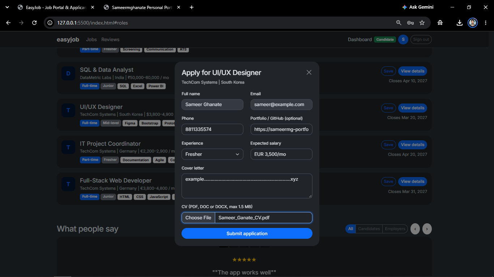
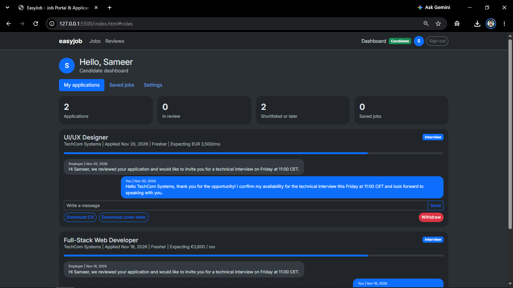
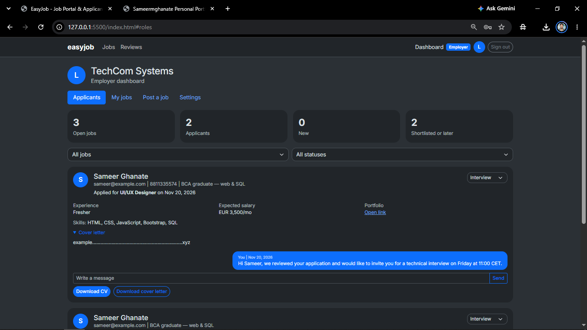
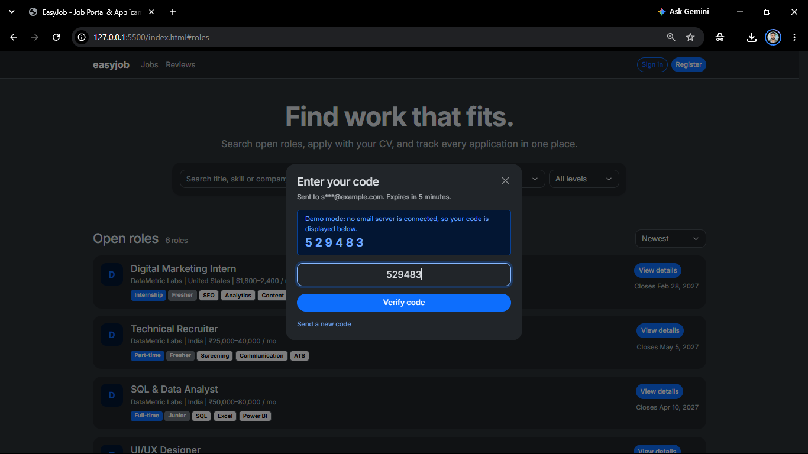

# EasyJob

EasyJob is a browser-based job portal and applicant tracking system built with HTML5, CSS3, vanilla JavaScript, Bootstrap 5, and SQLite (`sql.js`). It was developed for my BCA final-year project at Karnatak University, Dharwad, and packaged as a static web build so anyone can test it directly in a browser without setting up a backend server or local database.

## Live Demo

- Live site: https://easyjob-xi.vercel.app/
- Portfolio: https://sameermg-portfolio.vercel.app/

## Screenshots ### Job Application & CV Upload  ### Candidate Dashboard & Messaging  ### Employer Applicant Tracking Dashboard  ### OTP Password Recovery (Demo Mode) 

## Clone and Run Locally

```bash
git clone https://github.com/sameer26412/Easyjob.git
cd Easyjob
```

Run it through a local HTTP server (do not open `index.html` directly over `file://`, because browsers restrict WebAssembly and the Web Crypto API on local file URLs):

```bash
# Option 1: Python
python3 -m http.server 5500

# Option 2: Node / npx
npx serve .
```

Or open the folder in VS Code, install **Live Server**, right-click `index.html`, and click **Open with Live Server**.

## Requirements

- Any modern browser (Chrome, Edge, Firefox, or Safari) with WebAssembly and Web Crypto API support.
- Active internet connection to load Bootstrap 5.3.2, `sql.js` 1.8.0, and the Inter font from CDNs.
- Local server (`http://localhost`) or HTTPS host (such as Vercel) so `crypto.subtle` password hashing works properly.
- No build step, npm dependencies, or separate `assets/` folder are needed.

## Project Structure

```text
Easyjob/
├── index.html       # Main layout, search filters, job list, reviews, dashboard container, modal & toast
├── css/
│   └── style.css    # Custom theme adjustments on top of Bootstrap 5
├── js/
│   ├── db.js        # sql.js loader, table creation, demo seed data, localStorage persistence
│   └── app.js       # Search, auth/OTP flow, candidate & employer dashboards, file downloads
├── sql/
│   └── schema.sql   # Standalone copy of the SQLite schema for reference
└── README.md
```

## Project Scope

**Included:**
- Public job search with keyword matching, 4 dropdown filters (category, location, job type, experience level), and 3 sort orders.
- Role-based accounts for candidates (`seeker`) and employers (`employer`) with registration, sign-in, and OTP password reset.
- Candidate dashboard: apply with cover letter and CV upload (`.pdf`, `.doc`, `.docx` up to 1.5 MB), track 6 hiring stages (`Submitted`, `In review`, `Shortlisted`, `Interview`, `Offered`, `Rejected`), bookmark jobs, message employers, download submitted files, and withdraw applications.
- Employer dashboard: post, preview, and delete vacancies, filter applicants by job and stage, change application status, message candidates, and download applicant CVs and cover letters.
- Profile editing, `256 x 256` canvas-cropped profile photo upload, Light/Dark/System theme toggle, and a review carousel (one review per user).

**Out of scope:**
- Server-side backend API and shared multi-user database.
- Real email or SMS delivery for password reset OTPs.
- Paid job postings, pagination, and automated unit/E2E tests.

## Important Technical Details

- **Relational schema in the browser:** Uses 6 tables (`users`, `jobs`, `applications`, `messages`, `saved_jobs`, `reviews`) with primary keys, foreign keys (`ON DELETE CASCADE`), `CHECK`, and `UNIQUE` constraints.
- **SQLite pragma fix:** In `sql.js`, calling `db.export()` resets SQLite PRAGMA settings. `persist()` in `js/db.js` runs `PRAGMA foreign_keys = ON` again right after every export so cascading deletes keep working after writes.
- **Parameterized queries:** All SQL queries use bound parameters (`?` / `?1`), sorting uses a fixed `SORT` whitelist, and profile updates only allow columns listed in `PF`.
- **Basic XSS and ownership checks:** User text is passed through `esc()` before rendering, portfolio links must start with `http://` or `https://`, profile photos are checked for `data:image/` prefixes, and sensitive actions check user role and record ownership first.

## Demo Accounts

The database seeds 3 accounts, 6 sample jobs, 1 sample application with 2 messages, and 4 reviews on first load:

| Role      | Username    | Password   |
| :-------- | :---------- | :--------- |
| Candidate | `sameer`    | `sameer12345` |
| Employer  | `employer`  | `admin123` |
| Employer  | `employer2` | `admin123` |

Note: The pre-seeded sample application only has a placeholder CV name (`Sameer_CV.pdf`) without an attached binary file. Submit a new application with a real PDF or DOCX file to test CV downloads.

To reset the database back to its default seed state, open DevTools -> **Application** -> **Local Storage**, delete `easyjob_db` and `easyjob_sess`, and reload the page.

## Positives (What Works Well)

- Zero-setup deployment on static hosts like Vercel or GitHub Pages.
- Uses real SQL joins, aggregations (`COUNT`, conditional `SUM`), upserts (`ON CONFLICT`), and cascading deletes instead of static JSON arrays.
- Clear split between the database layer (`js/db.js`) and UI/application logic (`js/app.js`).
- Lightweight vanilla JS setup with no heavy frameworks or build tooling.

## Negatives and Known Limitations

This is a college prototype and portfolio demo, not a production recruitment platform. Known weaknesses:

- **Client-side access control can be bypassed:** Because there is no backend server, all login, role, and ownership checks run in browser JavaScript. Anyone using DevTools can inspect `localStorage` or modify checks locally.
- **Unsalted SHA-256 hashing:** Passwords are hashed in the browser using unsalted SHA-256 (`crypto.subtle.digest`). Production systems need slow, salted server-side hashing such as Argon2id or bcrypt.
- **Demo OTP handling:** Recovery codes are generated with `Math.random()` (not cryptographically secure) and shown directly inside the modal because no mail server is connected.
- **Plain session storage:** `easyjob_sess` stores a plain numeric user ID in `localStorage` without signed tokens or expiry times.
- **Single-browser data and storage quota:** Each browser keeps its own isolated copy of the SQLite database in `localStorage` (roughly 5-10 MB limit). Uploading several large CVs can fill browser storage.
- **Basic file type checks:** CV size (1.5 MB) is checked in JS, while file type relies on the HTML file picker (`accept=".pdf,.doc,.docx"`) rather than checking file headers.
- **No pagination, SRI hashes, or automated tests:** All matching jobs render at once, CDN links do not include integrity hashes, and verification is manual.

## Future Scope

Because `sql/schema.sql` is already normalized, moving this to production mainly requires:
1. Hosting the schema in PostgreSQL or MySQL behind an authenticated REST API.
2. Switching to Argon2id/bcrypt password hashing and expiring `HttpOnly` session cookies.
3. Sending OTPs over SMTP using a cryptographically secure random generator.
4. Storing CVs in object storage (S3/R2) with server-side MIME verification.
5. Adding pagination and automated unit/integration tests.


## Author

Sameer Ghanate  
BCA, Karnatak University, Dharwad  
Portfolio: https://sameermg-portfolio.vercel.app/
